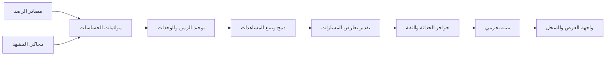

# المعمارية الأولية

## مبدأ التصميم

يبقى منطق الخطر مستقلًا عن نوع الكاميرا أو الحساس أو مكتبة الذكاء الاصطناعي. يبدأ التطوير ببيانات اصطناعية ومحاكاة، ثم تُستبدل الموائمات فقط بعد اعتماد الأجهزة والتجارب.

## حدود الوحدات

- `domain`: تعريف الرصد والمسار والخطر والحالة؛ لا يعتمد على مكتبات رؤية أو عتاد.
- `application`: تنسيق ingest → normalize → associate/fuse → assess → notify، وإدارة حالات الاستخدام.
- `ports`: واجهات مجردة للساعة، ومصادر المشاهدات، ومخرج التنبيه، والتخزين.
- `adapters`: محاكي اصطناعي أولًا؛ لاحقًا موائمات الكاميرا والحساس والعرض بحسب قرار معماري.
- `safety`: حداثة البيانات، اكتمال المصادر، الثقة، وتعامل الفشل/عدم اليقين.

## عقود البيانات التي يجب تثبيتها قبل الدمج

- كل مشاهدة تحمل `sensor_id` ووقت رصد UTC ووقت استلام ودرجة ثقة ومصدر/نسخة خوارزمية.
- لا تخلط إحداثيات البكسل مع إحداثيات العالم. الإحداثيات المكانية تحمل إطارًا مرجعيًا ووحدات ومعايرة معروفة.
- هوية الجسم احتمالية بين الحساسات؛ لا تعامل معرّفات المصدر على أنها هوية مؤكدة.
- نتيجة الخطر تتضمن السبب والمشاهدات الداخلة وأعمارها ودرجة الثقة، لا لون/جرس فقط.
- حالات الخرج صريحة: `CLEAR_WITHIN_SCOPE`, `HAZARD_SUSPECTED`, `DEGRADED`, `UNKNOWN`. لا تعني `CLEAR_WITHIN_SCOPE` ضمان السلامة خارج مجال النموذج.

## تدفق المعالجة

1. استلام المشاهدة والتحقق من المصدر والوقت والوحدات.
2. رفض/تمييز البيانات المتقادمة أو غير المتزامنة وفق حدود تعتمد في جلسة المتطلبات.
3. ربط المشاهدات بين المصادر بقدر الثقة، مع إبقاء عدم اليقين.
4. تقدير تقاطع المسارات وزمن الوصول إلى نقطة التعارض على السيناريو المعاير فقط.
5. إصدار تنبيه محاكاة أو حالة تدهور/عدم معرفة مع سبب قابل للشرح.
6. حفظ مقاييس وبيانات اصطناعية لازمة للتقييم، دون حفظ فيديو خام افتراضيًا.

## قرارات مؤجلة

نوع الكاميرا والحساس، نموذج الرؤية، إطار المعايرة، بروتوكول IoT، جهاز الحوسبة الطرفية، واجهة العرض، مخطط البيانات، وحدود الإنذار. تسجل القرارات في `docs/decisions/` مع بدائلها وأثرها.

## تحديث نطاق 30 أكتوبر 2026

أصبحت المنصة منتجًا تكامليًا لإدارة المشروع وتشغيل النموذج وعرضه. راجع [حزمة التصميم للمراجعة](blueprint/README.md) للاتفاقات والجداول والخطة. المعمارية الأولية أعلاه تخص نواة المجسم؛ لا تصف باك إند المنصة. الجلسات الثماني نقاط مراجعة وليست حصرًا لجلسات التنفيذ.
