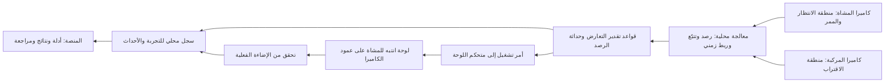

# ظل الخطر — متطلبات النموذج وتجربة إثبات الفكرة

الإصدار 0.1، 2026-10-31. تصميم أولي للمراجعة؛ لا عتاد متوفر ولا شراء معتمد. أكد سفيان أن الفكرة على الورق فقط. هوية المشروع وآلية اللوحة على عمود الكاميرات معتمدتان؛ الأبعاد والمكونات والحدود العددية أدناه مقترحات.

## الهدف والمخرج

إثبات أن رصد المشاة من زاوية مستقلة عن السائق، مع رصد اقتراب المركبة، يمكنه تشغيل تنبيه خارجي عند تعارض محتمل تحجبه حافلة. المخرج الأول تجربة قابلة للتكرار ببيانات وأزمنة محفوظة، ثم نموذج طاولة يعمل. راصد تميمة؛ لا يحتاج هذا الإصدار روبوتًا متحركًا.

## مخطط الطاولة المقترح

قاعدة 120 × 80 سم كنقطة بدء تخطيطية، قابلة للتعديل بعد تجربة مجال الرؤية. طريق بطول 100 سم وعرض 40 سم، ومساران متوازيان بعرض 20 سم؛ الحركة من بداية الطريق نحو الممر قرب نهايته. حافلة ثابتة قبل الممر في المسار المجاور للرصيف، وسيارة في المسار الآخر تقترب من الخلف، ومجسم طفل على الرصيف عند طرف الممر. ليست هذه أبعادًا هندسية معتمدة أو تمثيلًا لمقياس طريق حقيقي.

كاميرا المشاة على جانب الرصيف ترى منطقة الانتظار والممر. كاميرا المركبة على الجانب المقابل ترى منطقة الاقتراب. لوحة التحذير مثبتة على عمود الكاميرا المقابلة، تواجه السيارة ولا تقع خلف الحافلة. يُتحقق من الحجب بكاميرا/صورة عند ارتفاع نظر سائق السيارة المصغرة، ومن رؤية كل حساس بصورة مستقلة. ارتفاع الكاميرات والمسافات النهائية تحدد بقياس مجال الرؤية، وليس بصورة الهوية.

## المتطلبات ومعايير القبول

| الرمز | المتطلب | دليل القبول |
|---|---|---|
| R01 | إثبات أن الحافلة تحجب الطفل عن موضع السائق بينما تراه كاميرا المشاة | صور مواضع ومعايرة ثابتة لكل تجربة |
| R02 | تمييز وجود مشاة بمنطقة الانتظار/الممر | حالات وجود وغياب مع حقيقة مرجعية وتوثيق الأخطاء |
| R03 | تمييز مركبة تقترب باتجاه الممر | تتبع مواضع متتالية واختبار الاقتراب والابتعاد والتوقف |
| R04 | تشغيل التنبيه عند مشاة في المنطقة مع مركبة مقتربة في نطاق التجربة ورصد حديث | سجل يشرح الشرط الذي فعّل كل تنبيه |
| R05 | تشغيل لوحة فعلية مرئية من موضع السائق | فيديو أو قياس ضوئي مستقل؛ إقرار المتحكم وحده غير كافٍ |
| R06 | إنهاء التنبيه بعد زوال الحالة دون تذبذب سريع | تجربة خروج وتكرار ظهور؛ مهلة الإنهاء محفوظة ضمن إعدادات التشغيل |
| R07 | كشف تقادم الرصد أو فقد كاميرا/اتصال | حالة غير متاح وسببها؛ لا تُعرض على أنها غياب خطر |
| R08 | استقلال التنبيه المحلي عن المنصة والإنترنت | تجربة فصل المنصة مع استمرار دورة التنبيه المحلية |
| R09 | قابلية تكرار النتائج | نسخة كود وإعدادات ومواضع ومصادر وملفات أدلة لكل تشغيل |

حدود الثقة، عمر البيانات المقبول، نطاق الاقتراب ومهلة الإنهاء وزمن الاستجابة المستهدف تُضبط في تشغيل تجريبي ثم تُثبّت قبل مجموعة التقييم. لا تُختار لاحقًا لإخفاء إخفاقات النتائج.

## منطق التشغيل المقترح

الحالات: تهيئة، جاهز للرصد، تنبيه، غير متاح. الجاهزية تعني صلاحية الرصد وليست حكمًا بأن الطريق آمن. يبدأ التنبيه عند اجتماع وجود مشاة في المنطقة واقتراب مركبة ضمن نطاق محدد مع بيانات حديثة. وجود المشاة وحده أو مركبة تبتعد لا يحقق شرط التنبيه في هذه التجربة. لا ندّعي تقدير نية الطفل من صورة واحدة.

عند فقد البيانات أثناء التنبيه تُسجل حالة غير متاح فورًا. سياسة إبقاء الإضاءة التحذيرية أو تغيير نمطها تُحسم وتختبر قبل توصيل العتاد؛ لا تنطفئ باعتبار زوال الخطر بمجرد فقد الرصد. تستخدم الساعة المحلية الرتيبة لقياس المدد وUTC لتوثيق الأحداث. زمن المعالجة إلى الأمر منفصل عن الزمن حتى الإضاءة الفعلية.

## مراحل التجربة

| المرحلة | العمل والمخرج | بوابة الانتقال |
|---|---|---|
| E0 تثبيت التصميم | مخطط مواضع ومتطلبات وقائمة متاح وميزانية | مراجعة سفيان للأبعاد والنطاق |
| E1 محاكاة على الحاسوب | حركة ثنائية الأبعاد، حجب، رصد اصطناعي، منطق تنبيه وسجل | اجتياز السيناريوهات المنطقية؛ لا يعد إثباتًا لدقة الكاميرات |
| E2 تجربة بصرية مبكرة | كاميرا واحدة ثم اثنتان مع حافلة وطفل تجريبيين | إثبات أن مجسم الطفل قابل للرصد من المسافة المطلوبة |
| E3 دائرة التنبيه | ربط سلكي بمتحكم ولوحة منخفضة الجهد | تحقق إضاءة وفصل اتصال وتسجيل زمني |
| E4 التكامل والتقييم | تكرار السيناريوهات وتوثيق الإنذارات الخاطئة والفائتة | نتائج قابلة لإعادة التشغيل ومراجعة أسباب الفشل |
| E5 إخراج العرض | قاعدة نهائية وتغليف وأدلة وعرض الطالبين | بروفة كاملة وإصدار محفوظ |

النموذج المدرب على أشخاص حقيقيين قد لا يتعرف على طفل مصغر. تُختبر هذه الفرضية مبكرًا. يمكن استخدام علامة بصرية مؤقتة لاختبار دورة التشغيل مع وصفها صراحة؛ لا تُقدم نتائجها على أنها كشف أشخاص. اختيار نموذج أو بيانات/تدريب يأتي بعد نتيجة التجربة البصرية.

## مصفوفة التقييم

حالات مستقلة: طفل محجوب مع سيارة مقتربة؛ غياب الطفل؛ غياب المركبة؛ سيارة تبتعد؛ طفل خارج منطقة الانتظار؛ طفل ظاهر بلا حجب للمقارنة؛ زوال الحالة؛ فقد كاميرا؛ بيانات قديمة؛ فصل المتحكم؛ فصل المنصة. مقترح أولي: 10 تكرارات لكل حالة بعد مرحلة الضبط، وبترتيب متنوع، مع تسجيل الإضاءة والمواضع والسرعة.

نقارن مصدرًا واحدًا بمصدرين على السيناريو نفسه. نسجل عدد التنبيهات الصحيحة والخاطئة والحالات الفائتة ومقام كل نسبة، وزمن بدء شرط الخطر إلى التنبيه المرئي، والقيمة الوسطى وأسوأ زمن مرصود. لا نعمم نتائج المجسم على طريق حقيقي.

## الاحتياجات وخطة الشراء

| الدفعة | الاحتياج | الكمية التخطيطية | شرط الاختيار |
|---|---|---|---|
| قبل الشراء | حاسوب متاح للتطوير والتجربة | 1 | جرد مواصفاته ومنافذه؛ لا نفترض شراء حاسوب جديد |
| إثبات الرصد | كاميرات وحوامل ثابتة | حتى 2 | مجال رؤية وتركيز قريب وأداء متزامن مناسب؛ اختبار واحدة أولًا إن أمكن |
| إثبات الرصد | مجسمات حافلة وسيارة وطفل وخلفية طريق بسيطة | مجموعة | أحجام متوافقة وطفل يمكن اختباره بصريًا |
| التنبيه | متحكم بوصلة سلكية | 1 | متوافق مع المعالجة ومخارج اللوحة؛ النوع غير مختار |
| التنبيه | لوحة رمز مشاة وإضاءة كهرمانية ودائرة قيادة | 1 | وضوح من موضع السائق؛ تيار مناسب دون تحميل خرج المتحكم مباشرة |
| التنبيه | مصدر تغذية منخفض الجهد وأسلاك وموصلات | حسب التصميم | جهد وتيار الدائرة يحددان قبل الشراء |
| إخراج العرض | قاعدة وأعمدة ومواد تثبيت وتغليف | مجموعة | بعد ثبات مواضع الكاميرات والرصد |
| لاحق اختياري | تحريك آلي للسيارة | غير مقرر | الحركة اليدوية المضبوطة تكفي للتجربة الأولى |

لا توجد أسعار أو موديلات معتمدة. يُعد عرضان أو ثلاثة لكل احتياج بعد تحديد الميزانية والتوفر المحلي، مع سعر المصدر وتاريخه والشحن والضمان والتوافق. المجموع = القطع + الشحن + مواد التصنيع + احتياطي يحدده سفيان. لا شراء قبل اعتماد قائمة الدفعة.

## العمل والتوثيق

سفيان يعتمد المتطلبات ويُسند المهام ويقود التكامل. مقترح قابل للتعديل: سعود لتجهيز السيناريو ومواضع المجسم، مبارك لتسجيل التجارب والأدلة، مع تبادل الدورين. لا يعد هذا إسنادًا نافذًا دون قرار سفيان.

كل تشغيل يحتفظ بمعرفه، المشغل، السيناريو، نسخة الكود والإعدادات، المصادر وأعمار البيانات، التوقيت، أمر اللوحة ونتيجة التحقق الفعلي، الأخطاء، الأدلة والقرار التالي. لا نعتبر سجل القرارات الحالي تنفيذًا لجداول التجارب المخطط لها.

التتابع E0 إلى E5 هو البرنامج الأولي؛ التواريخ والمدة تعتمد على ساعات الفريق والتوريد. القرارات المطلوبة التالية: سقف الميزانية بالريال القطري، موعد العرض المستهدف، ساعات العمل الأسبوعية، مساحة الطاولة المتاحة ومواصفات الحاسوب الذي سيستخدم للتجربة.

