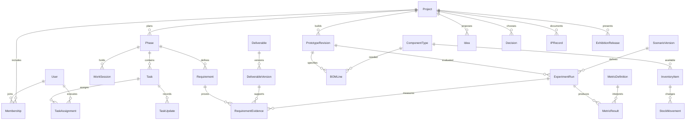

# قاموس الجداول والعلاقات المقترح

تاريخ: 30 أكتوبر 2026 — للمراجعة، بلا تنفيذ برمجي.

## الحسابات والتخطيط

| الجدول | أهم الحقول | العلاقة/الغرض |
|---|---|---|
| `User` | username, display_name, role, is_active | حسابات sufyan/saud/mubarak فقط؛ تخزين كلمات المرور عبر Django |
| `Project` | name, purpose, scope, status | المشروع الحالي؛ لا يفتح إنشاء مشاريع إضافية في الواجهة أولًا |
| `Membership` | project_id, user_id, role | Project N:M User؛ unique(project,user) |
| `Phase` | project_id, title, order, status | Project 1:N Phase |
| `Milestone` | phase_id, title, acceptance, status | Phase 1:N Milestone |
| `PlanBaseline` | project_id, version, approved_by, approved_at | نسخة خطة مقبولة غير قابلة للتحرير |
| `ScheduleEntry` | baseline_id, task_id, planned_start, planned_end, weight | Baseline 1:N Entry؛ unique(baseline,task) |
| `Task` | phase_id, milestone_id?, title, acceptance, status, priority, actual_start?, actual_end? | Phase 1:N Task؛ Milestone اختياري |
| `TaskAssignment` | task_id, user_id, assigned_by, assigned_at | Task N:M User؛ unique(task,user) |
| `TaskDependency` | predecessor_id, successor_id, kind | Task N:M Task؛ منع العلاقة بالنفس والدورات |
| `TaskUpdate` | task_id, author_id, summary, next_step, hours?, created_at | Task 1:N Update؛ الساعات اختيارية وغير سالبة |
| `Blocker` | phase_id, task_id?, owner_id, description, impact, status, resolved_at? | Phase/Task 1:N Blocker |
| `WorkSession` | phase_id, title, agenda, minutes, scheduled_at, held_at?, status | Phase 1:N Session؛ جلسات الفريق الهندسية |
| `Attendance` | session_id, user_id, attendance_status | Session N:M User؛ unique(session,user) |
| `Comment` | author_id, task_id?, session_id?, deliverable_id?, body | هدف واحد فقط بقيد CHECK؛ لا GenericForeignKey |
| `Announcement` | project_id, author_id, title, body, published_at? | Project 1:N Announcement |
## البحث والمتطلبات والقرارات

| الجدول | أهم الحقول | العلاقة/الغرض |
|---|---|---|
| `ResearchSource` | project_id, kind, title, url?, authors, publication_date?, accessed_at, summary, visibility | دراسة سوق أو بحث أو براءة أو مصدر داخلي |
| `Alternative` | project_id, source_id?, name, mechanism, limitations, price?, currency?, price_date? | حل منافس/بديل؛ السعر المجهول NULL لا صفر |
| `ComparisonCriterion` | project_id, name, unit?, definition | معيار مقارنة معرف قبل التقييم |
| `ComparisonFinding` | alternative_id, criterion_id, source_id, finding, value?, uncertainty | دليل لكل نتيجة مقارنة؛ لا اعتبار الدعاية قياسًا |
| `Requirement` | phase_id, code, statement, acceptance, verification_method, status | unique(project-scope code) عبر تحقق نطاق المشروع |
| `Idea` | project_id, author_id, title, rationale, status, created_at | فكرة إبداعية مؤرخة؛ رفض/تأجيل مع سبب |
| `Decision` | phase_id, session_id?, idea_id?, title, alternatives, rationale, status, supersedes_id? | قرار قابل للمراجعة؛ لا اعتماد تلقائي |
| `ChangeRequest` | project_id, proposer_id, reason, scope_impact, cost_impact?, schedule_impact, status, approved_by? | طلب تغيير مع أثر واعتماد |
| `Risk` | project_id, owner_id, description, likelihood, impact, mitigation, status | خطر محتمل؛ مستقل عن العائق الواقع |
## الملفات والإنتاج

| الجدول | أهم الحقول | العلاقة/الغرض |
|---|---|---|
| `FileAsset` | storage_key, original_name, media_type, bytes, sha256, visibility, uploaded_by | ملف خاص؛ التحقق من النوع والحجم وسياسة الوصول |
| `Deliverable` | phase_id, task_id?, title, kind, status | مخرج مرحلة أو مهمة؛ acceptance محفوظ |
| `DeliverableVersion` | deliverable_id, version, file_id?, text_snapshot?, author_id, submitted_at, accepted_by?, accepted_at? | unique(deliverable,version)؛ محتوى نصي أو ملف أو كلاهما |
| `RequirementEvidence` | requirement_id, deliverable_version_id, run_id?, verdict, reviewer_id? | ربط المتطلب بدليل محدد وإقرار المراجعة |
## المكونات والمشتريات

| الجدول | أهم الحقول | العلاقة/الغرض |
|---|---|---|
| `ComponentType` | project_id, name, kind, specifications, interface, voltage?, unit, safety_notes | تعريف نوع قطعة؛ المواصفات المتغيرة JSON محدود موثق |
| `InventoryItem` | component_type_id, label, serial?, ownership, condition, location | قطعة أو دفعة فعلية، بما فيها المعارة/المملوكة مسبقًا |
| `StockMovement` | inventory_item_id, task_id?, quantity_delta, reason, actor_id, occurred_at | دفتر حركة؛ الرصيد مشتق؛ الحجز مستقل عن الاستهلاك |
| `ResourceReservation` | inventory_item_id, task_id, quantity, from_at, to_at?, status | حجز/إرجاع معدات؛ لا يعد استهلاكًا |
| `Supplier` | name, contact?, url? | الحد الأدنى من بيانات المورد |
| `Quote` | component_type_id, supplier_id, quantity, unit_price, currency, shipping, tax, valid_until?, evidence_file_id? | السعر ومصدره وتاريخه؛ Decimal |
| `PurchaseOrder` | project_id, supplier_id, status, currency, approved_by?, ordered_at? | طلب شراء لا ينفذ دفعًا آليًا |
| `PurchaseLine` | purchase_order_id, component_type_id, quote_id?, quantity, unit_price | Order 1:N Lines |
| `Receipt` | purchase_line_id, inventory_item_id, quantity, received_by, received_at | استلام جزئي أو كامل؛ لا يتجاوز الطلب دون تعديل معتمد |
| `BudgetLine` | phase_id, category, planned_amount, currency, baseline_id? | ميزانية مرحلية؛ فصل العملات |
| `Expense` | purchase_order_id?, budget_line_id, amount, currency, paid_at, proof_file_id? | مصروف فعلي؛ لا تكرار جمع مبلغ الطلب معه |
## البرمجيات والذكاء الاصطناعي والنموذج

| الجدول | أهم الحقول | العلاقة/الغرض |
|---|---|---|
| `SoftwareComponent` | project_id, name, kind, purpose, repository_url?, license, alternatives | لغة/مكتبة/وحدة/خدمة/كونكتر |
| `SoftwareRelease` | component_id, version, git_sha?, artifact_file_id?, environment, approved_at? | إصدار مثبت؛ Git مرجع الكود |
| `ConnectorContract` | software_release_id, source, destination, transport, schema_version, units, clock_policy, failure_policy | واجهة اتصال محددة الإصدار؛ أسرارها خارج DB |
| `DatasetVersion` | project_id, name, version, manifest_file_id, provenance, license, split_policy | تقسيم وتوثيق البيانات؛ لا فيديوهات داخل DB |
| `ModelVersion` | project_id, name, version, weights_file_id?, dataset_version_id?, training_run_id?, license, configuration | مصدر الأوزان والتدريب؛ المستورد لا يتطلب TrainingRun |
| `TrainingRun` | dataset_version_id, software_release_id, parameters, seed?, environment, status, metrics, log_file_id? | تجربة تدريب محددة؛ JSON للإعدادات فقط |
| `PrototypeRevision` | project_id, version, description, status, approved_by? | نسخة مجسم مثبتة قابلة لإعادة التشغيل |
| `BOMLine` | prototype_revision_id, component_type_id, quantity, purpose | قائمة مواد التصميم؛ غير المخزون الفعلي |
| `PrototypeSoftware` | prototype_revision_id, software_release_id | Prototype N:M SoftwareRelease |
| `PrototypeModel` | prototype_revision_id, model_version_id | Prototype N:M ModelVersion |
| `SensorInstallation` | prototype_revision_id, inventory_item_id, sensor_key, position, coordinate_frame | موضع مصدر الرصد وإطاره المرجعي |
| `Calibration` | installation_id, version, parameters_file_id, measured_at, valid_until?, approved_by? | نسخة معايرة محددة؛ لا استبدال صامت |
| `WiringConnection` | prototype_revision_id, from_item_id, from_port, to_item_id, to_port, signal, diagram_file_id? | توصيل موثق وقطع مثبتة على النسخة |
## التجارب والتشغيل والعرض

| الجدول | أهم الحقول | العلاقة/الغرض |
|---|---|---|
| `Scenario` | project_id, name, objective, expected_behavior | سيناريو الحجب/الضوء/الانقطاع/التأخر |
| `ScenarioVersion` | scenario_id, version, configuration_file_id, seed?, ground_truth_file_id? | تثبيت السيناريو والحقيقة المرجعية |
| `ExperimentRun` | scenario_version_id, prototype_revision_id, operator_id, mode, started_at, ended_at?, environment, status | LIVE/SIMULATION/REPLAY؛ نسخة النموذج لا تعدل بعد التشغيل |
| `RunCalibration` | run_id, calibration_id | المعايرات المستخدمة فعليًا لا آخر معايرة فقط |
| `MetricDefinition` | project_id, code, definition, unit, aggregation, direction | تعريف البسط/المقام ومرجع زمن الإنذار |
| `MetricResult` | run_id, metric_id, value?, sample_count, uncertainty?, evidence_file_id? | القيمة غير المتوفرة NULL؛ شروط القياس موثقة |
| `RunFile` | run_id, file_id, role | ملفات القياسات والفيديو والسجلات؛ فهرس لا تدفق خام في DB |
| `AlertEvent` | run_id, sensor_installation_id?, observed_at, received_at, kind, confidence?, reason, source_event_id | قيد منع التكرار؛ زمن الرصد منفصل عن الاستلام |
| `ExhibitionRelease` | project_id, version, title, approved_by?, approved_at?, disclosure_id? | عرض منقح ومقبول؛ وضع المشرف افتراضي |
| `ExhibitionItem` | release_id, deliverable_version_id?, run_id?, display_order | هدف واحد؛ لا تضمين ملف خاص تلقائيًا |
## المساهمات والحقوق والتدقيق

| الجدول | أهم الحقول | العلاقة/الغرض |
|---|---|---|
| `Contribution` | project_id, user_id, kind, description, occurred_at, evidence_version_id? | سجل مساهمة؛ ليس حكمًا بصفة المخترع |
| `IPRecord` | project_id, kind, title, status, owner_claim?, agreement_file_id?, reviewer?, next_due? | معرفة سابقة/ترخيص/اتفاق/إجراء براءة؛ الادعاء ليس حسمًا |
| `Disclosure` | project_id, title, audience, disclosed_at?, status, approved_by?, evidence_file_id? | موافقة قبل كشف تفاصيل حساسة |
| `AuditEvent` | actor_id?, action, target_type, target_id, timestamp, safe_diff, correlation_id | append-only؛ معرف الهدف مرجع تاريخي عمدًا لا FK؛ يستثني الأسرار |

## قواعد المخطط
- هذا مخطط منطقي مقترح، وليس migrations أو جداول منفذة. يطبق على دفعات؛ لا نبني جميع المجالات في الإصدار الأول.
- معرفات UUID للكيانات، وUTC للتوقيت مع عرض Asia/Qatar. created_by/created_at/updated_at ومراجعة للسجلات القابلة للتعديل؛ لا نسخ من كامل البيانات الشخصية في audit.
- User مخصص في أول migration. الحسابات بأسماء دخول مسموحة محددة وقيد unique + CHECK لحصر الثلاثة؛ لا تسجيل عام ولا API لإنشاء رابع؛ مسؤول سفيان هو الحساب الإداري نفسه. استعادة الوصول لا تنشئ حسابًا إضافيًا.
- FK صريحة وPROTECT للنسخ المقبولة والتجارب والدفاتر؛ الأرشفة لمعظم الكيانات. CASCADE محصور بروابط المسودات التابعة غير المعتمدة.
- لا يربط عنصر من مشروع بعنصر من مشروع آخر: تحقق الخدمة والمعاملات، وإضافة قيد قاعدة مناسب عند تطبيق علاقات النطاق؛ FK منفرد لا يثبت تطابق المشروع.
- حقول «?» اختيارية. العملات ISO؛ Decimal للقيم المالية، لا float، ولا جمع عملات مختلفة دون سعر تحويل مؤرخ.
- تغييرات المخزون والحجز داخل معاملات مع قفل الصف المعني ومنع الرصيد/المتاح السالب. دفتر الحركة غير قابل للتحرير؛ التصحيح بحركة عكسية.
- اعتماد النسخة يسجل المراجع والتاريخ. تقدم المرحلة = مجموع أوزان المخرجات المقبولة / مجموع الأوزان المخططة؛ يضاف وزن إلى Deliverable في خطة تفصيلية أو جدول ربط BaselineDeliverable قبل التنفيذ. لا يساوي تقدم المهام الجاهزية التقنية.
- إجمالي TaskUpdate.hours يمثل ساعات اختيارية فقط، لا نسبة إنجاز. العمل المرسل للمراجعة ليس مقبولًا تلقائيًا.
- baseline الخطة الأصلية لا يستبدل. إنشاء baseline معدل يتطلب ChangeRequest مقبولًا؛ تربط النسخة الجديدة بالسابقة وبسبب التغيير عند تطبيق النموذج.
- منع الدورات في TaskDependency داخل خدمة تحت قفل نطاق المشروع؛ CHECK وحده لا يكفي لمنع الدورات.
- Comment يسمح بهدف واحد من Task/Session/Deliverable؛ بقيد قاعدة بيانات. التحقق من صلاحية الهدف قبل القراءة والكتابة.
- JSON للإعدادات التقنية المرنة ولقطات البيئة والفروق التاريخية؛ لا يستبدل علاقات المشتريات/المهام/الحسابات.
- فهارس FK تلقائية إضافة إلى (project,status)، (task,created_at)، (run,observed_at)، (target_type,target_id,timestamp). قياسات خام كبيرة تخزن ملفات مجزأة؛ لا تخزين كل إطار فيديو في PostgreSQL.
- نطاق LIVE لا يمنح الجهاز صلاحية تعديل المشروع. اعتماد أجهزة ورموزها يأتي في تنفيذ الاتصال، بمعرفات جهاز مستقلة عن حسابات المستخدمين، ودون حساب بشري رابع.
- الوسائط خاصة؛ تحقق الحجم والنوع والاسم الآمن وفحص الملفات قبل إتاحتها؛ روابط تنزيل قصيرة العمر بعد تحقق الصلاحية. عرض المسابقة يصدر فقط المواد المعتمدة.

## جداول ربط إضافية لازمة للتنفيذ
هذه جزء من المخطط وليست علاقات ضمنية: BaselineDeliverable(baseline_id,deliverable_id,weight)، TaskRequirement(task_id,requirement_id)، DecisionSource(decision_id,source_id)، IdeaSource(idea_id,source_id)، IdeaRequirement(idea_id,requirement_id)، RunRequirement(run_id,requirement_id)، IPContribution(ip_record_id,contribution_id)، IPSource(ip_record_id,source_id). قيد unique على كل زوج. القبول للمتطلبات عبر RequirementEvidence، ولا تحسب كل وصلة كدليل نجاح.

## سياسة الهجرات والتشغيل المقترحة
1. لا تغيير مباشر يدوي لقاعدة الإنتاج. migration صغيرة ومراجعة مع كل تغيير، ولا تعديل هجرة مطبقة.
2. التغيير الكبير بأسلوب إضافة ثم نقل البيانات ثم الانتقال ثم إزالة القديم في إصدار لاحق. ترحيل بيانات قابل للاستئناف وله عدادات تحقق.
3. تخطيط التراجع قبل الهجرة: التراجع بالكود لا يضمن تراجع قاعدة البيانات. نسخة احتياطية واستعادة مجربة قبل عمليات فقد البيانات.
4. نسخ منفصلة للتطوير والتجربة والإنتاج. أسرار خارج Git، DEBUG مغلق، ضوابط HTTPS والجلسة وCSRF والصلاحيات.
5. هجرات النشر تشغل مرة واحدة في خطوة منظمة، لا من كل نسخة خادم. إعداد Railway النهائي يراجع من وثائقه وقت التنفيذ.
6. تشغيل lint وفحص نماذج Django واتساق migrations، وتجربة إنشاء قاعدة فارغة وترقية نسخة سابقة واختبارات الصلاحيات والقيود والمعاملات قبل النشر.
7. سجلات مراقبة دون أسرار، فحص صحة وجاهزية، وسياسة نسخ احتياطي/احتفاظ واستعادة معتمدة قبل النشر الفعلي.

## مخطط العلاقات الرئيسية

