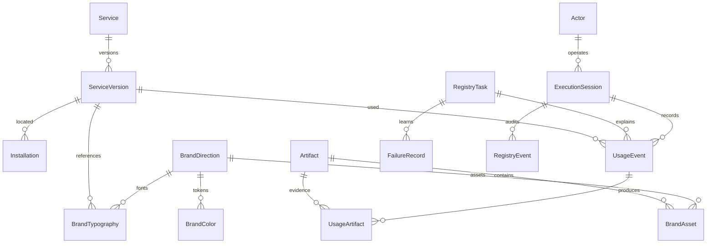

# سجل الخدمات والهوية — نطاق التنفيذ الفعلي

## المنفذ
نواة Django 5.2 LTS في backend، User مخصص في أول هجرة، وقاعدة تطوير محلية في backend/.local/registry.sqlite3. تتهيأ إعدادات PostgreSQL عند تقديم DATABASE_URL، لكن لم تنفذ تجربة PostgreSQL أو نشر Railway حتى الآن.

### العلاقات

الجرد يوثق موضع التثبيت وبصمة ملف التعليمات؛ اسم المهارة لا يكفي لمعرفة نسختها. وجود مهارة داخل cache لا يثبت تفعيلها في العميل. لم ننسخ محتوى المهارات ولا بيانات المستخدمين ولا أسرارهم.

UsageEvent يربط نسخة الخدمة والجلسة والمهمة والغرض وطريقة الاستعمال والنتيجة والوقت والأصول. recorded_at وقت تسجيل فعلي؛ used_at فارغ عند غياب وقت تنفيذ موثوق، ولا نخترع تاريخًا دقيقًا. البصمة تشير إلى ملف SKILL عند توفره، أو إلى وصف/أثر الخدمة مع توضيح أنها ليست بصمة محرك المزود.

BrandColor يحفظ token وHEX؛ RGB مشتق دون ازدواج. ألوان الطباعة وICC لم تعتمد. BrandTypography يربط الخط بملفه ونسخته وترخيصه. المقترحات مسودات، ولا توجد حزمة هوية منشورة أو نظام نشر تلقائي للـCSS بعد.

الأخطاء تشمل العَرَض، السبب المعلوم، التصحيح، الوقاية والدليل. لا تدعي النواة أنها تجمع كل أخطاء النظام أو تاريخ المحادثات تلقائيًا. سجل التدقيق محمي من التعديل في واجهة الإدارة وخدمة الاستخدام؛ مسؤول قاعدة البيانات يستطيع تعديلها تقنيًا، ولا ندعي مقاومة العبث الجنائي.

## الخطافات الحالية
- import_project_registry: استيراد ذري قابل للتكرار للجرد والاستخدامات والمقترحات.
- record_service_usage ENVELOPE.json: توثيق استعمال خدمة من ظرف JSON مراجَع؛ الغرض والكيفية والأثر إلزامية.
- registry.services.record_usage: خدمة داخلية ترفض إعادة استعمال معرف حدث بمحتوى متعارض أو بموضع تثبيت لا يطابق النسخة.
- لا توجد API عامة أو ربط آلي بعملاء خارجيين. المصادقة على الوكلاء وعقود الأدوار واستلام/تسليم المهام وتفويض الصلاحيات مراحل لاحقة.

## ما يزال تصميمًا
BrandRelease ونشر رموز التصميم وقوالب الطباعة، مواثيق الأدوار والذاكرة المعتمدة، اختيار الهوية ومراجعاتها، سياسة احتفاظ وإفصاح تفصيلية، قواعد منع تكرار الأخطاء تلقائيًا، مخزن الملفات الإنتاجي، CI ونشر Railway. الجداول المنفذة أساس لهذا التوسع وليست إعلان اكتمال المنصة.

## دورة دخول عنصر للخدمة
اكتشاف → تعريف الوظيفة والمصدر والترخيص → مراجعة → نسخة محددة → استخدام مرتبط بمهمة → توثيق الأثر → تقييم → اعتماد أو إيقاف. الاستخدام التجريبي لا يعني اعتمادًا عامًا. الأصول والخطوط والمهارات والنماذج والعملاء تدخل نفس سجل Service مع علاقاتها المتخصصة.

## الملكية والمراجعة
الحسابات البشرية مسموحة فقط لسفيان وسعود ومبارك. لم نفعل أي حساب أو ننشئ كلمة مرور. Actor الخاص بـCodex هوية تنفيذ وليست حساب دخول رابعًا. إصدار الهوية لا يصبح معتمدًا إلا بقرار بشري؛ قاعدة البيانات تشترط مراجعًا وتاريخًا عند حالة approved، أما واجهة الاعتماد فلم تنفذ بعد.
